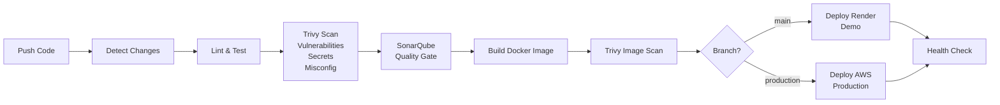

# TrekVN CI/CD Pipeline - Complete Guide

## 📋 Overview

TrekVN sử dụng GitHub Actions để tự động hóa quy trình CI/CD với **security-first approach**:

```
Push to GitHub → Trivy Security Scan → SonarQube Quality Gate → Auto-Deploy to Render
```

### Pipeline Flow



## 🔒 Security Scanning (Trivy)

### What is Trivy?

Trivy là **vulnerability scanner** của Aqua Security, quét:
- **Vulnerabilities**: CVE trong dependencies (npm packages, pip packages)
- **Secrets**: API keys, tokens, passwords trong code
- **Misconfigurations**: Dockerfile, YAML configs không an toàn

### Trivy in Pipeline

**Filesystem Scan** (trước khi build):
```yaml
- name: Trivy filesystem scan
  uses: aquasecurity/trivy-action@v0.36.0
  with:
    scan-type: fs
    scan-ref: backend/services/${{ inputs.service }}
    scanners: vuln,secret,misconfig
    severity: HIGH,CRITICAL
    exit-code: '1'  # Fail pipeline nếu tìm thấy HIGH/CRITICAL
```

**Image Scan** (sau khi build Docker):
```yaml
- name: Trivy image vulnerability gate
  uses: aquasecurity/trivy-action@v0.36.0
  with:
    scan-type: image
    image-ref: ghcr.io/owner/service:sha
    scanners: vuln
    vuln-type: os,library
    severity: HIGH,CRITICAL
    exit-code: '1'  # Fail nếu image có lỗ hổng HIGH/CRITICAL
```

### Trivy Reports

- Pipeline **fails** nếu phát hiện HIGH hoặc CRITICAL vulnerabilities
- Xem report tại: `Actions → Workflow Run → Trivy scan step`

Example output:
```
Total: 2 (HIGH: 1, CRITICAL: 1)

┌───────────────┬────────────────┬──────────┬───────────────────┬───────────────┬────────────────────────────┐
│    Library    │ Vulnerability  │ Severity │ Installed Version │ Fixed Version │           Title            │
├───────────────┼────────────────┼──────────┼───────────────────┼───────────────┼────────────────────────────┤
│ express       │ CVE-2024-29041 │ HIGH     │ 4.18.2            │ 4.19.2        │ express: XSS vulnerability │
└───────────────┴────────────────┴──────────┴───────────────────┴───────────────┴────────────────────────────┘
```

## 📊 Code Quality (SonarQube)

### What is SonarQube?

SonarQube là **code quality platform** phân tích:
- **Code Smells**: Code không tối ưu, khó maintain
- **Bugs**: Logic errors, potential bugs
- **Security Hotspots**: Code patterns dễ bị tấn công
- **Coverage**: Test coverage percentage
- **Duplications**: Duplicate code blocks

### SonarQube Quality Gate

Pipeline yêu cầu pass **Quality Gate** trước khi deploy:

```yaml
- name: SonarQube scan and Quality Gate
  uses: SonarSource/sonarqube-scan-action@v8.3.0
  with:
    projectBaseDir: backend/services/${{ inputs.service }}
  env:
    SONAR_TOKEN: ${{ secrets.SONAR_TOKEN }}
    SONAR_HOST_URL: ${{ vars.SONAR_HOST_URL }}
```

### Quality Gate Metrics (Default)

| Metric | Threshold |
|--------|-----------|
| Code Coverage | ≥ 80% |
| Duplicated Lines | ≤ 3% |
| Maintainability Rating | A |
| Reliability Rating | A |
| Security Rating | A |

### Setup SonarQube

**Option 1: SonarCloud (Recommended for Demo)**
1. Đăng ký tại: https://sonarcloud.io
2. Connect GitHub repository
3. Lấy token tại: Account → Security → Generate Token
4. Add GitHub secrets:
   ```
   SONAR_TOKEN: <your-sonarcloud-token>
   ```
5. Add GitHub variable:
   ```
   SONAR_HOST_URL: https://sonarcloud.io
   ```

**Option 2: Self-hosted SonarQube**
1. Deploy SonarQube server (Docker recommended)
2. Create project cho từng service
3. Generate token cho mỗi project
4. Update `SONAR_HOST_URL` và `SONAR_TOKEN`

### Disable SonarQube (Temporary)

Nếu chưa setup SonarQube, comment out trong `reusable-*.yml`:

```yaml
# - name: Require Sonar token
#   env:
#     SONAR_TOKEN: ${{ secrets.SONAR_TOKEN }}
#   run: |
#     if [ -z "$SONAR_TOKEN" ]; then
#       echo '::error::Configure repository secret SONAR_TOKEN'
#       exit 1
#     fi

# - name: SonarQube scan and Quality Gate
#   uses: SonarSource/sonarqube-scan-action@v8.3.0
#   ...
```

## 🚀 Deployment Strategy

### Render Auto-Deploy (Option A) ✅ CURRENT

**How it works:**
1. Render dashboard → Service → Settings → Build & Deploy
2. Enable "Auto-Deploy: Yes"
3. Connect GitHub repository
4. Set branch: `main`
5. **Khi push to main** → Render tự động deploy (không cần API call)

**Pros:**
- ✅ Zero configuration (no secrets needed)
- ✅ Automatic deployment on push
- ✅ Render dashboard shows build logs
- ✅ Simple và reliable

**Cons:**
- ❌ Không control được deploy timing chính xác
- ❌ Deploy tất cả services cùng lúc (không thể deploy từng service)

### Render Deploy Hooks (Option B) - If Needed Later

Nếu cần **control deploy timing** hoặc **deploy selective services**, dùng webhooks:

1. Render dashboard → Service → Settings → Deploy Hook
2. Copy deploy hook URL: `https://api.render.com/deploy/srv-xxxxx?key=yyyyy`
3. Add GitHub secret cho mỗi service:
   ```
   RENDER_DEPLOY_HOOK_API_GATEWAY: https://api.render.com/deploy/srv-xxxxx?key=yyyyy
   RENDER_DEPLOY_HOOK_AUTH_SERVICE: https://api.render.com/deploy/srv-xxxxx?key=yyyyy
   ...
   ```
4. Uncomment webhook code trong `.github/workflows/deploy.yml`

### AWS Deployment (Production) - Placeholder

Workflow đã chuẩn bị placeholder cho AWS:

```yaml
deploy-aws:
  name: Deploy to AWS (Production)
  if: needs.check-ci.outputs.deploy_env == 'aws'
  steps:
    - name: Deploy to ECS/EKS
      # TODO: Implement AWS deployment
```

**Để enable AWS deployment:**
1. Update logic trong `check-ci` job:
   ```yaml
   - name: Determine deployment environment
     id: env
     run: |
       if [[ "${{ github.ref }}" == "refs/tags/v*" ]]; then
         echo "deploy_env=aws" >> $GITHUB_OUTPUT
       elif [[ "${{ github.event.workflow_run.head_branch }}" == "main" ]]; then
         echo "deploy_env=render" >> $GITHUB_OUTPUT
       fi
   ```
2. Implement AWS deployment steps (ECS, EKS, Lambda, etc.)

## 🔧 GitHub Secrets Configuration

### Required Secrets (for SonarQube)

| Secret Name | Description | How to Get |
|-------------|-------------|------------|
| `SONAR_TOKEN` | SonarQube authentication token | SonarCloud → Account → Security → Generate Token |

### Optional Secrets (for Deploy Hooks - if using Option B)

| Secret Name | Description | Example |
|-------------|-------------|---------|
| `RENDER_DEPLOY_HOOK_API_GATEWAY` | Deploy hook cho api-gateway | `https://api.render.com/deploy/srv-xxxxx?key=yyyyy` |
| `RENDER_DEPLOY_HOOK_AUTH_SERVICE` | Deploy hook cho auth-service | `https://api.render.com/deploy/srv-xxxxx?key=yyyyy` |
| `RENDER_DEPLOY_HOOK_CHECKIN_SERVICE` | Deploy hook cho checkin-service | Same format |
| `RENDER_DEPLOY_HOOK_TREKKING_SERVICE` | Deploy hook cho trekking-service | Same format |
| `RENDER_DEPLOY_HOOK_AGENT_SERVICE` | Deploy hook cho agent-service | Same format |

### Repository Variables

| Variable Name | Description | Example |
|---------------|-------------|---------|
| `SONAR_HOST_URL` | SonarQube server URL | `https://sonarcloud.io` |

### How to Add Secrets

1. GitHub repo → Settings → Secrets and variables → Actions
2. Click "New repository secret"
3. Name: `SONAR_TOKEN`
4. Value: paste your token
5. Click "Add secret"

## 📁 Workflow Files

```
.github/
├── workflows/
│   ├── ci.yml                          # Main CI orchestrator
│   ├── reusable-node.yml               # Node.js services pipeline
│   ├── reusable-python.yml             # Python agent pipeline
│   ├── deploy.yml                      # Auto-deploy after CI success
│   └── archive/
│       └── deploy-render-manual.yml    # Old manual deployment (deprecated)
└── filters.yml                         # Path filters for change detection
```

### ci.yml - Main Orchestrator

- Detects which services changed
- Runs parallel pipelines for each changed service
- Uses reusable workflows
- Required status check for branch protection

### reusable-node.yml - Node.js Pipeline

1. **Lint**: `npm run lint`
2. **Test**: `npm run test:ci` (with coverage)
3. **Trivy Filesystem Scan**: vulnerabilities + secrets + misconfig
4. **SonarQube Analysis**: Quality Gate check
5. **Docker Build**: Create image
6. **Trivy Image Scan**: Container vulnerabilities
7. **Publish to GHCR**: (main branch only)

### reusable-python.yml - Python Pipeline

1. **Lint**: `ruff check`
2. **Test**: `pytest --cov`
3. **Trivy Filesystem Scan**
4. **SonarQube Analysis**
5. **Docker Build**
6. **Trivy Image Scan**
7. **Publish to GHCR**

### deploy.yml - Deployment

- Triggered by successful CI on `main` branch
- Deploys to Render (demo environment)
- Placeholder for AWS (production)
- Health check monitoring

## 🔄 CI/CD Workflow Execution

### 1. Developer Push Code

```bash
git add .
git commit -m "feat: add new feature"
git push origin develop
```

### 2. CI Pipeline Runs

GitHub Actions detects changes and runs:
- ✅ Lint (ESLint/Ruff)
- ✅ Tests (Jest/Pytest with coverage)
- ✅ Trivy filesystem scan (vuln, secrets, misconfig)
- ✅ SonarQube Quality Gate
- ✅ Docker build
- ✅ Trivy image scan (container vulnerabilities)
- ✅ Publish to GHCR (main branch only)

**Duration:** ~5-8 minutes per service (parallel execution)

### 3. Merge to Main

```bash
git checkout main
git merge develop
git push origin main
```

### 4. Auto-Deploy to Render

- Render detects push to `main` branch
- Automatically triggers deployment
- All 5 services rebuild and deploy
- **Duration:** ~3-5 minutes per service

### 5. Monitor Deployment

**Health Checks:**
- API Gateway: https://api-gateway-trekvn.onrender.com/health
- Auth Service: https://backend-trekvn.onrender.com/health
- Checkin Service: https://checkin-service-trekvn.onrender.com/health
- Trekking Service: https://trekking-service-trekvn.onrender.com/health
- Agent Service: https://agent-service-trekvn.onrender.com/health

**Render Dashboard:**
https://dashboard.render.com → View logs, metrics, deploy status

## 🐛 Troubleshooting

### Pipeline Fails at Trivy Scan

**Problem:** HIGH or CRITICAL vulnerabilities found

**Solution:**
```bash
# Update dependencies
npm update
npm audit fix

# Or update specific package
npm install package-name@latest

# Re-run Trivy locally (optional)
docker run --rm -v $(pwd):/scan aquasec/trivy fs /scan
```

### Pipeline Fails at SonarQube

**Problem:** Quality Gate failed (low coverage, code smells)

**Solution:**
1. View SonarQube report: SonarCloud dashboard → Project
2. Fix issues reported:
   - Add tests to increase coverage
   - Refactor code smells
   - Fix security hotspots
3. Re-push code

### Pipeline Fails at Build

**Problem:** Docker build fails

**Solution:**
```bash
# Test Docker build locally
cd backend/services/api-gateway
docker build -t test-image .

# Check Dockerfile for errors
# Check if all dependencies are in package.json
```

### Deployment Not Triggering

**Problem:** Push to main but Render not deploying

**Solution:**
1. Check Render dashboard → Service → Settings
2. Verify "Auto-Deploy: Yes"
3. Verify branch is set to "main"
4. Check GitHub integration is connected
5. Manual deploy: Render dashboard → Deploy → Deploy Latest Commit

### SonarQube Not Configured

**Problem:** `SONAR_TOKEN` secret not set

**Temporary Fix:**
Comment out SonarQube steps in `.github/workflows/reusable-*.yml` (see "Disable SonarQube" section above)

**Proper Fix:**
Setup SonarCloud and add `SONAR_TOKEN` secret (see "Setup SonarQube" section)

## 📊 Monitoring Integration

### Prometheus + Grafana

Xem hướng dẫn deploy Prometheus và Grafana tại:
- Prometheus Dockerfile: `backend/infrastructure/monitoring/prometheus/Dockerfile`
- Prometheus config: `backend/infrastructure/monitoring/prometheus/prometheus.yml`
- Grafana setup: Use Grafana Cloud (free tier)

**Next Steps:**
1. Deploy Prometheus to Render (web service)
2. Connect to Grafana Cloud
3. Import dashboards
4. Configure alerts

## 🎯 Best Practices

### Security

- ✅ **Never commit secrets** - Use environment variables
- ✅ **Keep dependencies updated** - Run `npm audit` regularly
- ✅ **Fix HIGH/CRITICAL vulnerabilities** immediately
- ✅ **Review Trivy reports** before merging
- ✅ **Enable branch protection** - Require CI to pass

### Code Quality

- ✅ **Maintain >80% test coverage**
- ✅ **Fix code smells** reported by SonarQube
- ✅ **Run linter** before committing: `npm run lint`
- ✅ **Write meaningful tests** - Don't just increase coverage %

### Deployment

- ✅ **Test locally** before pushing
- ✅ **Use feature branches** - Never push directly to main
- ✅ **Monitor deployments** - Check health endpoints after deploy
- ✅ **Rollback if needed** - Render dashboard → Redeploy previous version

## 📚 Additional Resources

- **GitHub Actions**: https://docs.github.com/en/actions
- **Trivy Documentation**: https://aquasecurity.github.io/trivy/
- **SonarQube**: https://docs.sonarqube.org/
- **Render Documentation**: https://render.com/docs
- **Docker Best Practices**: https://docs.docker.com/develop/dev-best-practices/

## 🆘 Support

Nếu gặp vấn đề với CI/CD pipeline:

1. Check Actions logs: GitHub → Actions → Failed workflow
2. Check Render logs: Render dashboard → Service → Logs
3. Review this documentation
4. Check service health endpoints
5. Contact DevOps team

---

**Last Updated:** 2026-10-17  
**Version:** 2.0 (Webhook-based deployment)  
**Status:** ✅ Production Ready
