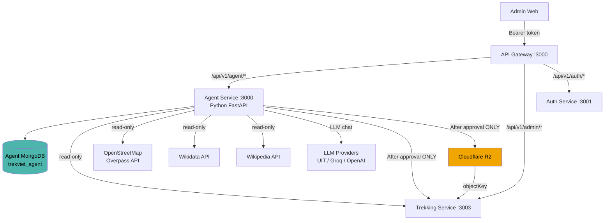

# Architecture — Agent Service

## Tổng quan



## 3 Flows riêng biệt

### Flow 1 — AI Assistant (Chat)

```
Admin → POST /api/v1/agent/assistant/conversations/:id/messages
  → AssistantService.send_message()
  → Build LLM context (capped history)
  → LLMProviderManager.chat()  ← UIT / Groq / OpenAI
  → Persist user + assistant messages
  → Return response + provider metadata
```

**V1 constraint:** Assistant tools = READ ONLY.
Không có tool nào có thể write production DB, trigger Place Builder, hoặc Map Builder.

---

### Flow 2 — Place Builder

```
Admin → POST /api/v1/agent/place-builder/jobs
  → PlaceBuilderService.create_job()  → 202 Accepted
  → Background task:
      validate_input
      → discover_osm        (Overpass API)
      → enrich_wikidata     (Wikidata API, soft-fail)
      → crawl_web           (Wikipedia API, soft-fail)
      → normalize           (deterministic mapping → production schema)
      → duplicate_check     (trekking-service read-only)
      → validate_candidate  (rule-based confidence score)
      → save_candidate      → status=PENDING_REVIEW

Admin reviews candidate via GET /candidates/:id
Admin edits if needed: PATCH /candidates/:id

Admin → POST /candidates/:id/approve
  → validate status=PENDING_REVIEW
  → require provinceId resolved
  → call trekking-service: CREATE or UPDATE place
  → mark APPROVED + productionSync
```

**Production write xảy ra DUY NHẤT sau khi Admin bấm approve.**

---

### Flow 3 — Map Builder

```
Admin → POST /api/v1/agent/map-builder/jobs
  → MapBuilderService.create_job()  → 202 Accepted
  → Background task (deterministic, no LLM):
      VALIDATE_INPUT   (bbox, zoom, injection check)
      PREPARE_WORKDIR  (/tmp/trekviet-agent/map-jobs/{jobId}/)
      EXTRACT_OSM      (Overpass API → .osm.xml)
      BUILD_MBTILES    (tilemaker → .mbtiles)
      BUILD_TERRAIN    (gdal — optional/skipped in V1)
      BUILD_CONTOURS   (gdal — optional/skipped in V1)
      BUILD_HILLSHADE  (gdal — optional/skipped in V1)
      BUILD_STYLE      (generate style.json for MapLibre)
      PACKAGE_ZIP      (manifest.json + style.json + .mbtiles → .zip)
      VALIDATE_ZIP     (SHA-256, manifest parse, bbox match)
      → status=PENDING_REVIEW

Admin downloads artifact: GET /jobs/:id/artifact
Admin reviews + tests in Flutter

Admin → POST /jobs/:id/approve
  → upload to Cloudflare R2
  → call trekking-service: update offlineMap metadata
  → status=PUBLISHED

Reject: DELETE temp files, status=REJECTED, no R2 upload
```

## Security Boundaries

| Layer | Enforcement |
|---|---|
| API Gateway | JWT verify via auth-service; `/api/v1/agent/*` in PROTECTED_PREFIXES |
| Agent Service | Re-validates JWT + checks role=ADMIN |
| Assistant | No write tools in V1 (code-enforced, not prompt-only) |
| Place Builder | Production write only at `/approve` endpoint |
| Map Builder | R2 upload only at `/approve` endpoint |
| Internal calls | Service token (`TREKVIET_INTERNAL_TOKEN`) — never exposed to browser |
| Agent MongoDB | Separate DB, never touches production trekking DB |

## Data Flow — R2 objectKey

```
Map Builder builds:   maps/nui-ba-den/v1/nui-ba-den-v1-flutter.zip
                              ↓
Stored in MongoDB (Agent):  output.publish.r2.objectKey
                              ↓
Trekking-service stores:    trekking_places.offlineMap.objectKey
                              ↓
Flutter gets downloadUrl:   R2_PUBLIC_BASE_URL + "/" + objectKey
```

`downloadUrl` is **never stored** — built at runtime by `buildR2Url()`.
