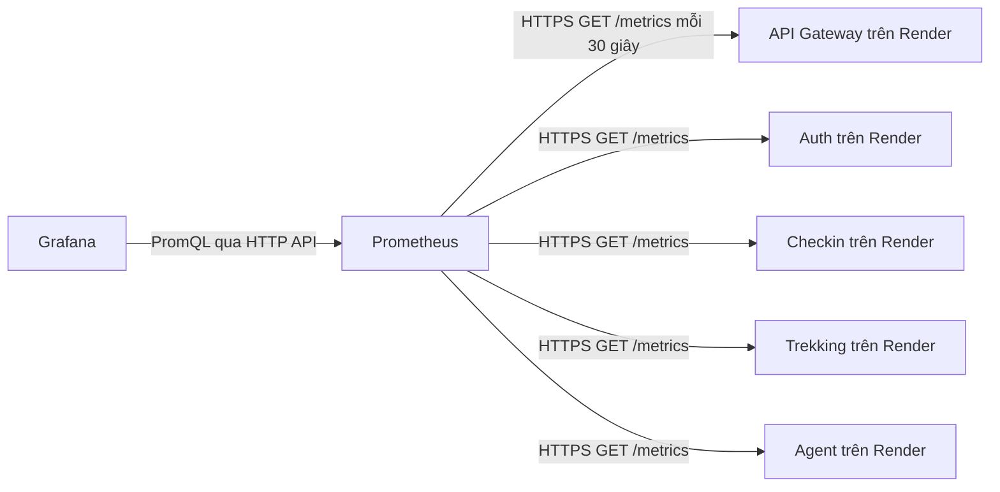

# TrekVN — Prometheus và Grafana

## Kết quả kiểm tra và phần đã bổ sung

Trước thay đổi này, chỉ API Gateway có `prom-client` và `GET /metrics`.
Auth, Checkin, Trekking và Agent chưa có endpoint metrics. Có sẵn cấu hình
Prometheus, Compose và provisioning Grafana, nhưng chưa có dashboard JSON.
Middleware cũ của Gateway bọc `res.send`, vì thế bỏ sót phản hồi do `http-proxy`
hoặc stream trả về bằng `res.end`.

Hiện cả 5 service có `GET /metrics`, HTTP counter/histogram/gauge và metrics tiến trình.
Gateway đo bằng sự kiện `finish/close`; Agent đo tại ASGI để bao gồm response stream.
Route labels dùng template hoặc nhóm prefix, tránh tạo một time series cho mỗi ID/query.
`community-service` hiện chỉ có cấu hình Sonar, chưa có ứng dụng để instrument.

**Đây là triển khai trong source code. Cần deploy lại service trên Render và khởi chạy
monitoring để có dữ liệu thật. Các hostname bên dưới lấy từ cấu hình cũ của repo,
chưa được xác nhận là hostname đang chạy của bạn.**

## Luồng kết nối



Một Prometheus dùng chung thu thập và lưu lịch sử của cả 5 service.
Grafana kết nối tới **Prometheus**, không nhập URL `/metrics` của từng service
vào ô URL của datasource Prometheus.

Cần có tiến trình collector chạy liên tục. Không bắt buộc thuê một máy riêng:
Prometheus và Grafana có thể chạy chung VPS/máy Docker, hoặc là hai service riêng
trên Render. Chạy ở laptop phù hợp thử nghiệm; tắt máy thì việc thu thập dừng.
Nếu dùng dịch vụ metrics được quản lý, collector và storage có thể do nhà cung cấp vận hành.

## 1. Deploy backend và kiểm tra API

Đặt cùng một giá trị bí mật ngẫu nhiên `METRICS_TOKEN` cho cả 5 service trên Render.
Token này dành cho monitoring, tách biệt JWT người dùng và token gọi API nội bộ.
Có thể dùng Environment Group trên Render. Deploy lại cả 5 service để nhận code,
dependency và biến môi trường mới.

Tạo token bằng PowerShell (chỉ tạo giá trị, không thay đổi dịch vụ Render):

```powershell
$metricsToken = [guid]::NewGuid().ToString('N') + [guid]::NewGuid().ToString('N')
```

Nếu không đặt `METRICS_TOKEN`, endpoint mở công khai để tiện development.
Trên Render nên đặt token và chỉ truyền qua HTTPS.

| Service | URL tham khảo từ cấu hình repo |
| --- | --- |
| API Gateway | https://api-gateway-trekvn.onrender.com/metrics |
| Auth | https://backend-trekvn.onrender.com/metrics |
| Checkin | https://checkin-service-trekvn.onrender.com/metrics |
| Trekking | https://trekking-service-trekvn.onrender.com/metrics |
| Agent | https://agent-service-trekvn.onrender.com/metrics |

Gọi trực tiếp domain của từng service, đường dẫn ở root là `/metrics`,
không có tiền tố `/api/v1`. Gateway chỉ xuất metrics của Gateway.

Ví dụ PowerShell, sau khi gán token đúng với Render:

```powershell
$metricsToken = 'TOKEN_DA_DAT_TREN_RENDER'
curl.exe -i -H "Authorization: Bearer $metricsToken" https://api-gateway-trekvn.onrender.com/metrics
curl.exe -i -H "Authorization: Bearer $metricsToken" https://backend-trekvn.onrender.com/metrics
curl.exe -i -H "Authorization: Bearer $metricsToken" https://checkin-service-trekvn.onrender.com/metrics
curl.exe -i -H "Authorization: Bearer $metricsToken" https://trekking-service-trekvn.onrender.com/metrics
curl.exe -i -H "Authorization: Bearer $metricsToken" https://agent-service-trekvn.onrender.com/metrics
```

Kỳ vọng HTTP 200, `Content-Type: text/plain`, nội dung bắt đầu bằng các dòng
`# HELP` / `# TYPE`. Đây là định dạng Prometheus, không phải JSON.
401 nghĩa là thiếu/sai token; 404 thường là chưa deploy code mới hoặc sai URL.
Endpoint không yêu cầu JWT và được đăng ký trước limiter của API.

## 2. Chạy Prometheus và Grafana chung bằng Docker Compose

Cần Docker Engine/Docker Desktop có Compose. Chạy tại thư mục
`backend/infrastructure/monitoring`:

```powershell
Copy-Item .env.example .env
New-Item -ItemType Directory -Force secrets
Set-Content -LiteralPath secrets/metrics_token -Value $metricsToken -Encoding ascii -NoNewline
```

File `secrets/metrics_token` chỉ chứa token, không có chữ `Bearer`, không có dấu nháy.
Dùng token giống giá trị trên cả 5 service. `secrets/` và `.env` được Git bỏ qua.

Mở `.env`, điền mật khẩu mạnh vào `GRAFANA_ADMIN_PASSWORD`.
Sửa `prometheus/prometheus.yml`, thay từng `targets` bằng hostname thật trên Render
(không có `https://`, không có `/metrics`). Scheme và path đã cấu hình riêng.
Prometheus không tự thay `${METRICS_TOKEN}` trong YAML; cấu hình đọc secret file.

```powershell
docker compose config --quiet
docker compose run --rm --no-deps --entrypoint promtool prometheus check config /etc/prometheus/prometheus.yml
docker compose run --rm --no-deps --entrypoint promtool prometheus check rules /etc/prometheus/alerts.yml
docker compose run --rm --no-deps --entrypoint promtool -v ./prometheus/alerts.test.yml:/etc/prometheus/alerts.test.yml:ro prometheus test rules /etc/prometheus/alerts.test.yml
docker compose up -d
docker compose ps
```

- Prometheus: http://localhost:9090/targets — cả 5 job cần hiển thị UP.
- Grafana: http://localhost:3100 — đăng nhập bằng user/password trong `.env`.
- Dashboard tự nạp: **Dashboards → TrekVN → TrekVN — Services Overview**.
- Nếu dùng Grafana có sẵn: thêm datasource kiểu Prometheus trỏ tới URL
  Prometheus mà máy Grafana truy cập được; sau đó import
  `grafana/dashboards/trekvn-services.json` và chọn datasource ở dropdown.

Trong Compose, URL datasource tự cấu hình là `http://prometheus:9090`.
Nếu Grafana chạy trực tiếp trên cùng máy còn Prometheus publish cổng local,
dùng `http://localhost:9090`. Trong container Grafana, localhost là chính container đó.

Các cổng mặc định chỉ bind `127.0.0.1`. Trên VPS có thể dùng SSH tunnel để xem:
`ssh -L 3100:localhost:3100 -L 9090:localhost:9090 user@vps`.
Nếu cần truy cập công khai, cấu hình reverse proxy HTTPS/xác thực.
Đổi `GRAFANA_ROOT_URL` theo URL Grafana thực tế.

Sau khi sửa config, chạy `docker compose restart prometheus`.
Dữ liệu Compose dùng named volumes; tránh `docker compose down -v` nếu muốn giữ lịch sử.

## 3. Nếu muốn chạy monitoring trên Render

**Prometheus**:

1. Tạo Docker Private Service cùng region/workspace với Grafana.
2. Với repo Backend-TrekVN: Root Directory là
   `backend/infrastructure/monitoring/prometheus`, Dockerfile là `./Dockerfile`,
   Docker Build Context là `.`.
   Nếu repo kết nối là monorepo TrekVN, thêm tiền tố `Backend-TrekVN/` vào Root Directory.
3. Thêm Secret File tên `metrics_token`, nội dung là cùng token đã dùng cho backend.
   Render đặt file ở `/etc/secrets/metrics_token`, đúng đường dẫn cấu hình.
4. Gắn persistent disk tại `/prometheus` (cần plan hỗ trợ disk).
5. Service lắng nghe cổng 9090. Giữ Prometheus trong private network;
   không cần mở API Prometheus công khai cho các backend.
6. Đổi hostname các targets trong source trước khi build/deploy. Các targets mặc định
   dùng public HTTPS Render, nên Prometheus có thể chạy bên ngoài Render.

**Grafana**:

1. Tạo Docker Web Service, Root Directory
   `backend/infrastructure/monitoring/grafana`, Dockerfile `./Dockerfile`,
   Docker Build Context `.`.
2. Đặt `PORT=3000`, `GF_SECURITY_ADMIN_USER=admin`,
   `GF_SECURITY_ADMIN_PASSWORD=<mat-khau-manh>`,
   `GF_SERVER_ROOT_URL=https://<grafana-domain>`.
3. Đặt `PROMETHEUS_URL=http://<prometheus-internal-hostname>:9090`.
   Lấy hostname thật từ trang Connect/Internal của Prometheus trên Render.
   Cùng region/workspace để Grafana truy cập private service.
4. Gắn disk tại `/var/lib/grafana` để giữ tài khoản/cấu hình.
   Dashboard provisioning nằm ở `/etc/grafana`, không bị disk che mất.
5. Deploy và mở Dashboard như hướng dẫn Compose.

Render Free không hỗ trợ persistent disk và có thể ngủ khi không có traffic;
cold start có thể khiến scrape timeout, `up=0`, và mất mẫu.
Prometheus lưu lịch sử trên disk nên cần nơi chạy ổn định, có storage bền vững.

## Metrics và truy vấn dùng trên Grafana

| Metric | Ý nghĩa |
| --- | --- |
| `up{service="auth-service"}` | Prometheus scrape thành công = 1, thất bại = 0; không phải kiểm tra DB |
| `trekvn_http_requests_total` | Request đã kết thúc, labels service/method/route/status_code |
| `trekvn_http_request_duration_seconds_bucket` | Histogram độ trễ HTTP |
| `trekvn_http_requests_active` | Request đang xử lý |
| `process_resident_memory_bytes` | RAM của tiến trình ứng dụng |
| `process_cpu_seconds_total` | CPU time tích lũy, dùng rate để ra số CPU core sử dụng |
| `nodejs_*` / `python_*` | Runtime metrics tương ứng Node/Python |

Ví dụ PromQL:

```promql
sum by (service) (rate(trekvn_http_requests_total[5m]))

histogram_quantile(0.95,
  sum by (le, service) (rate(trekvn_http_request_duration_seconds_bucket[5m]))
)

sum by (service) (rate(trekvn_http_requests_total{status_code=~"5.."}[5m]))
/
sum by (service) (rate(trekvn_http_requests_total[5m]))
```

Dashboard có trạng thái scrape, requests/s, lỗi 5xx, P95, RAM, CPU, active request và 429/s.
Cần phát sinh request và chờ ít nhất 2 lần scrape để `rate()` có kết quả.
CPU/RAM là của tiến trình service, không phải toàn bộ máy host Render.
Không triển khai MongoDB/Redis/LLM token metrics trong thay đổi này.

Metrics HTTP cũ của Gateway `trekvn_gateway_http_*` chuyển sang
`trekvn_http_*` với label `service="api-gateway"`. Queries/alerts cũ cần đổi tương ứng.
Các metric proxy/upstream trước đây chỉ được khai báo, chưa được cập nhật trong proxy code;
các alert dùng những series không được xuất đã được bỏ khỏi bộ mặc định.

Mặc định chỉ chạy Prometheus và Grafana. `alerts.yml` được đánh giá và xem trong
Prometheus; email/Slack cần cấu hình thêm Alertmanager. File mẫu
`alertmanager/alertmanager.yml` cũ vẫn còn nhưng không được khởi chạy tự động.
Không có Node Exporter trong stack mặc định: exporter trên máy monitoring chỉ đo
máy monitoring, không đo host các service trên Render.

Bản hiện tại dùng một process Node và một Uvicorn worker cho mỗi instance
(Agent Dockerfile đã đặt `--workers 1`). Khi scale nhiều replica/worker,
cần scrape riêng từng instance hoặc dùng collector/multiprocess phù hợp;
scrape qua một public domain được load balance không đảm bảo tổng đầy đủ.

## Kiểm thử

```powershell
# Từ mỗi Node service (api-gateway/auth-service/checkin-service/trekking-service),
# sau khi chạy npm ci trong chính service đó:
node node_modules/jest/bin/jest.js tests/integration/metrics.test.js --runInBand

# Từ backend/services/agent-service, sau khi cài requirements:
python -m pytest tests/test_metrics.py
```

Node service giữ module metrics trong thư mục riêng để Docker build độc lập;
test Gateway kiểm tra các bản đó đồng nhất. Mỗi service chạy test metrics bằng dependency
của chính nó, không cần cài node_modules cho service khác. Các test kiểm tra token, quota bypass, route labels,
counter, stream, proxy thật, client abort, lỗi 500 và app factory.

## Tài liệu chính thức

- [Prometheus configuration](https://prometheus.io/docs/prometheus/latest/configuration/configuration/)
- [Grafana Prometheus datasource](https://grafana.com/docs/grafana/latest/datasources/prometheus/configure/)
- [Render secret files](https://render.com/docs/configure-environment-variables#secret-files)
- [Render Free limitations](https://render.com/docs/free)
- [Render persistent disks](https://render.com/docs/disks)
